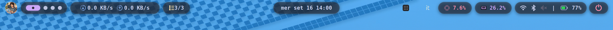

# AngieBar

```text
    ___                _      ____             
   /   |  ____  ____ _(_)__  / __ )____ ______ 
  / /| | / __ \/ __ `/ / _ \/ __  / __ `/ ___/ 
 / ___ |/ / / / /_/ / /  __/ /_/ / /_/ / /     
/_/  |_/_/ /_/\__, /_/\___/_____/\__,_/_/      
             /____/                            
```



**AngieBar** is a sleek, modern, high-performance status bar for GNOME Shell, inspired by the minimalist aesthetics of Waybar and the interactive utility of modern floating "islands". It transforms your standard GNOME panel into a modular, pill-based interface featuring pixel-perfect styling, rich hover tooltips, and real-time system monitoring.

---

## 🚀 Key Features

### ✨ Interactive Dynamic Island
Expandable from the center clock/media pill on hover or click (with pin support and automatic GNOME accent color matching):
- **🔔 Pill Notifications**: Displays incoming notifications directly in the center pill (replacing stock GNOME banners) alongside a dedicated **Notifications** tab.
- **🎵 Media Player (Music)**: Full-bleed album art card with MPRIS2 playback controls, animated progress scrubber, multi-player switching, and audio output device selector.
- **📅 Calendar & Agenda**: Interactive monthly calendar grid with quick event creation and local persistence (`~/.config/angiebar-events.json`).
- **📝 To-Do & Google Tasks Sync**: Multi-list task manager shared with the panel To-Do badge (`~/.config/angiebar-todos.json`), topic visibility filters, and optional **Google Tasks** synchronization via GNOME Online Accounts.
- **⏱️ Pomodoro Timer**: Focus, short break, and long break phases with a live compact timer pill, configurable durations, auto-start transitions, and custom break colors.
- **📋 Clipboard Manager**: Tracks copied text, links, recent screenshots, and files with search, pinning, category filters, and configurable auto-expiry (TTL).
- **🤖 AI Assistant**: Summonable via the island header or global shortcut (`Super+Shift+A` by default), supporting CLI agents (`agy`, `codex`, `claude`), local inference (Ollama / OpenAI-compatible endpoints like vLLM or LM Studio), and an optional confirmation prompt before running system commands.

### 📌 Interactive Logo Island
- **Custom Logo Support**: Choose any custom PNG, JPEG, or SVG image (supports full cover fill or centered icon mode).
- **Left-Click Action**: Configurable to launch a custom command or open an interactive dropdown menu.
- **Quick-Access Menu**: Provides quick links to GNOME Settings, customizable folder shortcuts (Documents, Downloads, Desktop, Pictures), Terminal, and real-time **System Uptime**.
- **Right-Click Overview**: Toggle GNOME Overview instantly with a right click.

### 📝 Panel To-Do Badge
- **Real-Time Counter**: Displays pending/total tasks (`X/Y`) right on the top bar and opens directly into the Dynamic Island To-Do tab on click.
- **Persistent Storage**: Automatically saves your lists and tasks to `~/.config/angiebar-todos.json`.

### 🎧 Compact Media & Audio Visualizer Pill
- **MPRIS2 Integration**: Automatically detects media playback from Spotify, Firefox, Chrome, VLC, Celluloid, and more.
- **Album Art & Visualizer**: Displays cover art dynamically alongside a minimalist "Nothing" style animated wave effect during active playback.

### 📊 Real-Time System Monitors
- **CPU Usage & Stats**: Shows live total CPU load percentage. Hovering reveals core frequencies (MHz), temperatures (°C), and usage details.
- **RAM Monitor**: Displays memory load percentage. Hovering shows exact RAM usage in GB (e.g. `4.2GB / 15.6GB`).
- **Network Speed Monitor**: Live upload and download speed indicators (`KB/s` / `MB/s`). Click to toggle compact average speed view.

### 🛡️ Privacy & System Indicators
- **Privacy Indicator Island**: Automatically detects live microphone and camera activity (`PipeWire`), displaying a hover tooltip listing active apps using your hardware.
- **Quick Settings Module**: WiFi status (hover for SSID, signal %, local IP), Bluetooth state, and Volume indicator with **mouse scroll-to-change volume** support (`wpctl`).
- **Battery Utility**: Dynamic SVG battery icon rendering charge level and status colors. Click to toggle wattage draw (`W`), hover for time to full/empty.
- **Power Button**: Dedicated button for one-click power off or custom session actions.

---

## 🎨 Design & Customization

AngieBar features a built-in GTK4 / Libadwaita preferences window (`prefs.js`):

- **Module Toggles**: Easily enable or disable individual bar islands and Dynamic Island tabs.
- **Color Themes & Presets**: Includes quick theme presets (Catppuccin Mocha, Catppuccin Macchiato, Nord, Dracula, Gruvbox, Dark Red, Dark Green, Absolute Black).
- **Custom Background & Opacity**: Adjust hex/rgba background colors and island transparency (`0.00` to `1.00`).
- **Accent Customization**: Change text and icon colors independently for CPU, RAM, and active workspace dots (while the Dynamic Island automatically syncs with your GNOME accent color).
- **Dynamic Island, Pomodoro, To-Do & AI Settings**: Configure hover-to-open, pill notifications, clipboard TTL, Google Tasks sync, Pomodoro durations, AI provider/local endpoint, and the AI keyboard shortcut.

---

## 🛠️ Installation

### Quick Install (Script)

Clone the repository and run the installation script:

```bash
git clone https://github.com/garrati-0/AngieBar.git
cd AngieBar
chmod +x install.sh
./install.sh
```

### Manual Installation

1. Create the local extension directory:
   ```bash
   mkdir -p ~/.local/share/gnome-shell/extensions/AngieBar@garrati.com
   ```
2. Copy all files into that directory:
   ```bash
   cp -r * ~/.local/share/gnome-shell/extensions/AngieBar@garrati.com/
   ```
3. Compile the GSettings schema:
   ```bash
   glib-compile-schemas ~/.local/share/gnome-shell/extensions/AngieBar@garrati.com/schemas/
   ```
4. Restart GNOME Shell (`Alt` + `F2`, type `r`, press `Enter`, or re-login on Wayland).
5. Enable the extension using **GNOME Extensions** or **Extensions Manager**.

---

## 📋 Requirements

- **GNOME Shell**: 45 to 51
- **System Dependencies**:
  - `libadwaita` (for preferences window)
  - `network-manager` (for Wi-Fi SSID & IP info)
  - `upower` (for battery stats & wattage)
  - `wireplumber` / `pipewire` (for volume control via `wpctl` and privacy monitoring)

---

## 📄 License

Distributed under the GPL-3.0 License. See `LICENSE` for more information.

---

*Made with ❤️ by [garrati](https://github.com/garrati-0)*
